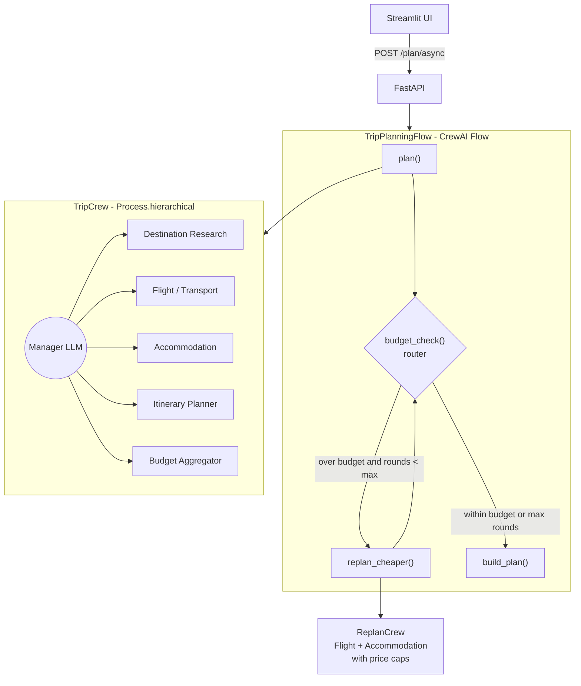

# Trip Planning Agent

A multi-agent trip planner built with **CrewAI**. A hierarchical manager agent coordinates five specialists: destination research, flights, accommodation, itinerary and budget. A **budget feedback loop** then re-searches cheaper flights and stays whenever the plan comes in over budget.

It runs entirely on free tiers. The LLM is Groq (gpt-oss-120b) or Gemini Flash, and the external services are Tavily/Serper, OpenWeatherMap, OpenRouteService and exchangerate-api.

## Architecture



- **Hierarchical crew** ([crew.py](src/trip_planner/crew/crew.py)): CrewAI creates a manager agent from `manager_llm`. The manager runs each task and delegates it to a specialist. Tasks declare explicit `context=` dependencies: stays depend on research, the itinerary on research and stays, and the budget on flights, stays and the itinerary. Every task returns a Pydantic model ([models.py](src/trip_planner/models.py)).
- **Budget feedback loop** ([flow.py](src/trip_planner/flow.py)): the Flow router reads the budget computed in code ([budget.py](src/trip_planner/budget.py)), so the loop never depends on LLM arithmetic. When the plan is over budget, the overage is split across flights and accommodation in proportion to their cost. A small `ReplanCrew` then re-searches under those caps. A new option is adopted only if it is cheaper, so the total never goes up between rounds. The loop stops after `MAX_BUDGET_ITERATIONS` rounds, and the UI charts the total for each round.
- **Guardrails in code**: if a re-search fails (for example, LLM quota runs out), the flow returns the best plan found so far with a warning instead of failing. Estimated flights keep only their dates, since models invent flight numbers and times. Warnings flag an itinerary with missing days and a cheaper stay in a different neighbourhood from the one the itinerary was planned around. Each `TripPlan` reports `llm_tokens`, the total LLM tokens the run used.
- **Agent vs. code**: the Budget Aggregator agent writes the suggested trims. If its total disagrees with the computed one, the computed total wins and the mismatch shows up as a warning.

### Why CrewAI (not AutoGen or LangGraph)
Trip planning is sequential, hierarchical delegation (flights → hotels → itinerary → budget check), not an open-ended conversation that has to converge. CrewAI's role/task/process model maps directly onto that. Its Flows add the one controlled loop the design needs, without hand-building a whole state graph.

## Tools

| Tool | API (free tier) | Notes |
|---|---|---|
| `web_search` | Tavily (1k/mo) or Serper (2.5k free) | whichever key is set |
| `weather_forecast` | OpenWeatherMap | 5-day forecast only; agents fall back to search for climate |
| `search_flights` | Amadeus Self-Service → search estimate | provider chain, see limits below |
| `travel_times` | OpenRouteService | geocode + duration matrix, used to cluster sights per day |
| `convert_currency` | exchangerate-api / open.er-api.com | works without a key |

All API responses are cached in SQLite (`.cache/api_cache.sqlite`) so development runs don't use up quota. Error responses are never cached. Tools never raise: they return `{"error": ...}` so the agent can adapt.

## Setup

CrewAI does not support Python 3.14 yet, so use **Python 3.10–3.13**.

```bash
py -3.12 -m venv .venv          # Windows (python3.12 -m venv .venv elsewhere)
.venv\Scripts\activate
pip install -e ".[dev]"
copy .env.example .env          # then fill in at least GROQ_API_KEY + TAVILY_API_KEY
```

To switch LLMs, set `LLM_MODEL=gemini/gemini-2.0-flash` and `GEMINI_API_KEY`. CrewAI 1.x has no native Groq provider, so `config.get_llm()` sends `groq/...` models to Groq's OpenAI-compatible endpoint.

## Run

```bash
# CLI (prints the TripPlan JSON); a low budget forces the feedback loop
python -m trip_planner.flow --origin Mumbai --destination Lisbon --nights 4 --budget 800

# API
uvicorn trip_planner.api:app --reload      # http://localhost:8000/docs

# UI (with the API running)
streamlit run app/streamlit_app.py
```

### API
- `POST /plan`: blocking call. Takes a `TripRequest` and returns a `TripPlan`.
- `POST /plan/async` then `GET /plan/{job_id}`: an async job that the UI polls. Jobs are held in memory.
- `GET /health`

## Sample run

A live run through the API (Mumbai → Lisbon, 15–19 Nov 2026, 1 traveller, $800 budget, food + history), on the free Groq tier:

| Round | Flights | Stay (4 nights) | Total |
|---|---|---|---|
| 1 | — (manager returned no flights) | $200 | $814 |
| 2 | $529 | $55 | $1,198 |
| 3 | $287 | $55 | $956 |

- It used **212k LLM tokens** over 3 rounds. The Groq wrapper recovered 1 fake `json` tool call and retried 4 rejected ones.
- The trip finished $156 over budget, mostly because the itinerary agent estimated $80/day for local transport.
- That run exposed two bugs that are now fixed and covered by regression tests. Round 1's missing flights produced a flight cap of $0. A plan with no flights could also look under budget.

The itinerary covered all 5 days with 3–4 activities each. All flight prices were search *estimates*, since no Amadeus key was set.

## Tests

```bash
pytest
```

The 40 tests cover the budget math, the flow router (under budget, over budget then converging, hitting the max-rounds cap, ignoring results that cost more, surviving a failed replan, flagging an agent total mismatch), the guardrails, tools with mocked `httpx` (parsing, caching, error payloads, Amadeus → estimate fallback), the Groq wrapper (recovering pseudo tool calls, retries, the daily-quota fallback chain), the API endpoints, and the Streamlit UI rendered headlessly with `AppTest`. No API keys or LLM calls are needed.

## Known limits
- **Flight data**: free flight APIs are limited. Amadeus Self-Service uses a test environment with cached, partial inventory, and Amadeus has announced it is retiring the self-service portal, so check its current status. Without working Amadeus credentials, flights fall back to *estimates* from search results. Every flight carries a `source` field, and the UI shows whether a price is a live quote or an estimate.
- **Hotel prices** come from web search, so treat them as estimates.
- **Free-tier rate limits**: a hierarchical run makes many LLM calls. `MAX_RPM`, a low `max_iter` per agent, compact tool outputs and the cache keep runs within Groq's free limits. (Groq has retired LLaMA 3.3 70B, so the default is now `groq/openai/gpt-oss-120b`.) If Groq's tokens-per-minute cap is hit, switch to Gemini.
- **Groq tool-call quirks**: Groq rejects a whole request (400 `tool_use_failed`) when a model's tool call is invalid. The gpt-oss models do this regularly: they "call" a fake `json` tool to deliver their final answer, call a tool when tools are switched off, or send malformed arguments. [llm.py](src/trip_planner/llm.py) recovers the answer or retries. For the same reason, tool argument schemas carry no min/max bounds; the code clamps values instead.
- **Token budget**: Groq's free tier allows 200k tokens/day and 8k tokens/minute *per model*. The manager runs on `gpt-oss-120b` and the specialists on `gpt-oss-20b`, so each draws on its own quota. For cheap development runs, use `CREW_PROCESS=sequential`. When a model's daily quota runs out, calls switch to the next model in `GROQ_FALLBACK_MODELS` (default: gpt-oss-120b → gpt-oss-20b → qwen3.8-27b), and every agent skips that model until its quota window reopens. If every model is exhausted, the run stops with a clear `QuotaExhaustedError`.
- **Replan scope**: replanning re-searches flights and stays only. The itinerary is kept, since activity costs are usually a small share of the total.
